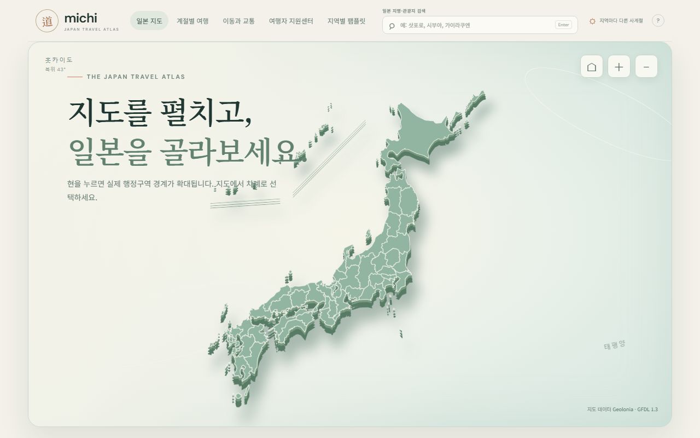
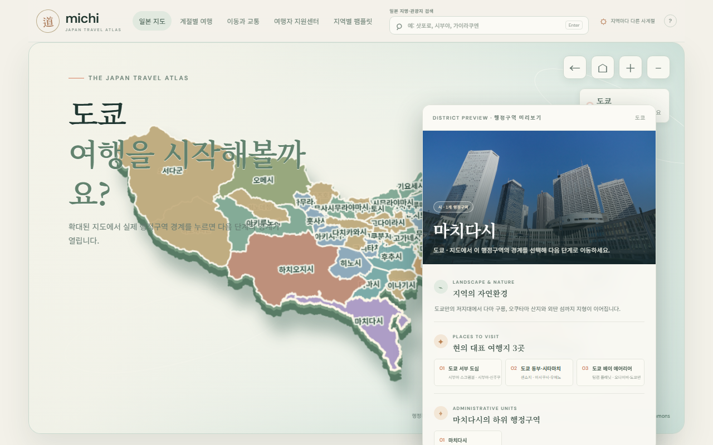

# W4 이슈 점수 적용 준비와 SVG 가림 실험

확인일 2026-11-18. main `355f286` 기준. 원준 W4 메모·ADR 0011 2번을 따랐다.
이 기록은 **정식 가중치 튜닝 완료나 미치 전체 과업 성공 보고가 아니다.**

## 현재 완료 범위

| 항목 | 결과 |
|---|---|
| GitHub 할당·열린 이슈 확인 | 원준 할당 열린 이슈 없음. 전체 열린 #72는 코어·PM 담당 |
| 점수 계산 | 측정 특징만 쓰는 휴리스틱, 명시적 설정, 경계·결측 처리 구현 |
| 서비스 연결 | 설정을 준 run만 행동 전 대상 증거 수집 → agent 전체 종료 → 최종 DB 저장 |
| 비교 도구 | 기존 요소 일치 규약 그대로 특징을 연결해 규칙만/설정별 점수 비교 |
| 실사이트 판정 준비 | 2인 CSV 입력·범주형 Cohen κ·누락/불일치 보고 도구 |
| 미치 SVG 조사 | 중심점 오판 재현, 실험 모드에서 도쿄 번호 클릭 후 구 선택 화면 진입 |
| 정식 가중치·임계값 선택 | 0차 실행 자료를 찾지 못해 대기. 기본 설정을 임의로 정하지 않음 |
| 미치 원래 과업 3회 | 검색 목록·Enter·drag 경로가 별도 코어 작업이라 미실행 |
| 로지스틱 회귀 ablation | 선택 과제. 정식 자료가 없어 미실행 |

## 0차 자료를 확인한 범위

- 로컬 `data/`, `benchmark/evidence/`에서 summary·measurement·features·score 파일을 검색했다.
  11/17·11/18 사전 점검 summary만 있었고 정식 run 자료는 없었다.
- 11/18 `benchmark.run_development --preflight`는 PostgreSQL 설정 없음·모델 키 없음,
  32케이스 중 29개 고정 빌드 누락을 보고했다. 준비된 세 과업도 실행하지 않았다.
  준비 실패를 무검출이나 과업 실패 결과로 세지 않는다.
- [PR #67](https://github.com/hanchaehun/StepMeter/pull/67)과 main의
  `docs/w3-infra-status.md`는 스테이징 연결 3/3 검증과 정식 32케이스 평가를 구분한다.
- GitHub의 `development-benchmark-evidence` artifact(14196132040)를 내려받아 확인했다.
  [실행 43799365107](https://github.com/hanchaehun/StepMeter/actions/runs/43799365107)의
  `development/summary.json`은 개발 앱 빌드·렌더링 검증이며 정확도·agent E2E가
  아니라고 명시한다. 정식 튜닝 입력으로 사용하지 않았다.
- Notion 연결은 세 페이지 모두 접근 오류(404)였고 browser host도 사용할 수 없었다.
  최신 Notion 변경을 읽었다고 주장하지 않는다. 로컬 W4 메모와 main·GitHub를 기준으로 했다.
- 홀드아웃 파일·이름·정답과 참가자 자료는 읽지 않았다.

따라서 실측 정밀도·재현율·+0.05 달성 여부와 선택된 가중치는 **미측정**이다.
테스트의 가중치와 합성 정답은 서비스 설정이나 실측 성능으로 보고하지 않는다.

## 점수 처리

```text
행동 전 실제 대상 식별 → 후보·step 저장(confidence=1.0 잠정값)
모든 agent 시도 종료 → 시도별 지표 → run 중앙값 → 최종 점수 저장 → run 완료
```

설정이 없으면 기존 경로를 유지한다. 설정은 run 시작 때 한 번 읽으며,
run 처리 중 변경하지 않는다. 점수 특징·정규화·설정 형식·결측·로그 수집은
[ml/issue_clf/README.md](../ml/issue_clf/README.md)에 있다.

- 동일 run의 종료 agent 전체가 분모다. 실패·무검출 포함, 같은 시도 중복 1표, replay 제외.
- 대상은 화면+행동 전 DOM 구조 경로+의미 지문이다. axe는 실제 selector를 사용한다.
  실제 axe 대상의 역할·면적은 행동 snapshot으로 추정하지 않고 null로 둔다.
  구조가 바뀌는 동적 목록에서는 반복 검출을 적게 셀 수 있다.
- 최종 점수는 기존 `confidence`, `is_reference`, `score_reason`에 저장한다.
  임계값과 같으면 기본 목록, 미만이면 참고. 기존 참고 후보는 승격하지 않는다.
- replay와 step 없는 run 단위 참고 규칙은 기존 값을 유지한다.
  취소·미완료·대상 증거 누락 시 최종 저장을 중단한다. 설명·이슈 ID·검토 라벨은 유지한다.
- `STEPMETER_ISSUE_SCORE_CONFIG`는 운영자가 검증한 파일에만 설정한다.
  설정 해시·분모·이유는 score_reason, 전체 설정·특징 버전·후보별 특징은 INFO 로그에 남긴다.
  버전은 `issue-features-v1` / `issue-score-v1`이다.
- 비교기는 기존 승인 정답·실제 DOM 요소 일치 규약을 쓴다. 6개 규칙만 채점하고
  (케이스, 규칙, 요소) 중복을 제거한다. 누락·실패 케이스와 다른 규칙은 따로 보고한다.
  정밀도 상승과 함께 재현율 손실도 검토해야 한다. 자동 배포는 하지 않는다.

## 미치 재현과 실험

공개 [미치](https://michi-japan-travel-atlas.satinylake10.chatgpt.site/), Chromium,
1280×800. 모델 호출·검색 제출·drag 없이 `도쿄 여행 안내` 한 번만 번호로 클릭했다.

| 관측 | 값 |
|---|---|
| 첫 관찰 요소 수 | 60 |
| 도쿄 의미 대상 | g, role=button, 이름=도쿄 여행 안내 |
| bbox | x=696.487, y=497.806, 37.869×107.091 CSS px |
| 기본 중심 판정 | occluded=true, 대신 잡힌 대상=지도 svg |
| 실험 조작 지점 | x=711.871, y=554.698 |
| 실험 판정·행동 | occluded=false, 실제 마우스 클릭, dom_mutation |
| 행동 후 독립 확인 | 지요다구 선택 등 도쿄 구 선택 항목이 나타남 |





도쿄 대상은 path가 아닌 g였으며, 단순 CTM 역변환만으로는 실제 화면의 도형을
찾지 못했다. 최종 실험은 [CSSOM View의 전체 paint stack](https://drafts.csswg.org/cssom-view/#dom-document-elementsfrompoint)
에서 SVG 도형이 있는 지점을 선택하고 기존 최상단 hit-test로 가림을 확인한다.
가림 여부로 다음 지점을 찾지 않으므로 덮개를 피하는 클릭이 되지 않는다.
31×31 고정 격자는 매우 작은 도형을 놓칠 수 있으며 이 경우 중심으로 돌아간다.

동결 명세는 중심 판정이므로 **실험을 기본 활성화하지 않았다.** 검증 페이지의
`__stepmeterSvgGeometry=true`에서만 적용한다. PM이 판정 정의를 결정한 뒤
동결 문서·적용 정책을 별도 정리해야 한다. schemas.py·openapi.yaml은 바꾸지 않았다.

도쿄 진입은 원래 과업인 “시부야구 여행 안내 열기”의 성공이 아니다.
검색 목록 유지·Enter 지원·실제 패널 아래 가림과 drag 문제를 따로 해결해야 하며,
실제 과업 3회 결과나 기존 9건 R04 전체가 오탐이라는 주장은 하지 않는다.

로컬 증거(커밋 제외): `benchmark/evidence/w4-michi-final/report.json`, before/after.png,
`data/w4/michi-final.log`, 사전 점검 `data/w4/preflight-20261118/summary.json`.
공개 지도 화면의 전후 스크린샷만 위 문서에 포함했다.

## 검증

- SVG 회귀 10개: 기본 중심 계약, 분리 도형, g, 실제·부분 overlay, 관찰 후 overlay,
  CSS 3D 변환, iframe 변환, open shadow를 Chromium에서 확인했다.
- 점수 손계산·임계값 동일 경계·결측·설정 검증, 종료 분모·중복·참고 유지·롤백·취소,
  실제 axe 대상·replay 제외, 기존 채점기→특징→비교기 연결을 검사했다.
- 가짜 모델을 주입한 agent 실행에서 명시 설정이 최종 DB 점수와 완료 상태로 연결됨을 확인했다.
  실제 모델 품질이나 PostgreSQL 잠금 검증을 대신하지 않는다.
- Ruff, 지정 mypy, `git diff --check` 통과. 웹 95개·typecheck·build 통과.
- 전체 Python 606개 실행: 532개 통과·환경 의존 73개 skip·boto3 미설치 오류 1개.
  고정 requirements-dev.txt 설치 후 해당 R2 테스트 4개를 다시 돌려 모두 통과했다.
  오류를 숨기기 위해 코드나 기대값을 고치지 않았다.
- 최종 W4 관련 검사 31개와 마지막 실행 연결·재생 검사 2개 통과.
  기록: `data/w4/full-tests.log`, `data/w4/w4-final-tests.log`,
  `data/w4/final-run-connection.log`. 로컬 전체 검사는 PostgreSQL·Redis 서비스
  잠금/마이그레이션 검증을 대신하지 않는다.

## 협업 이슈 초안 (게시하지 않음)

### SVG 판정 정의와 미치 전체 경로

- **제목:** `[W4 미치] 도쿄 SVG 가림 재현·실험 확인과 기본 적용 기준 결정`
- **받는 사람:** 한채훈(PM), 배송현(코어), 강민수(사전 측정)
- **내용:** 도쿄 g의 37.869×107.091 bbox 중심이 지도 svg를 hit해 가림으로 잡히는 것을 재현했습니다.
  전체 paint stack으로 도형 지점을 고른 실험에서는 번호 클릭 후 도쿄 구 선택 화면으로
  넘어갔습니다. 현재 동결 정의는 중심 판정이라 기본 비활성으로 두었습니다.
  SVG의 조작 지점 예외를 승인할지 확인 부탁드립니다. 검색창 목록·Enter 지원과
  시부야구의 실제 가림/drag 경로를 정한 뒤 원래 과업을 3회 재측정하면 좋겠습니다.

### 정식 튜닝 자료와 설정 동결

- **제목:** `[W4 이슈 점수] 0차 자료 전달과 가중치·임계값 검토 요청`
- **받는 사람:** 전철우(회귀·인프라), 배송현(코어), 김도현(규칙), 한채훈(PM)
- **내용:** 점수 계산·명시 설정·전체 agent 종료 후 confidence/is_reference 저장과 비교 도구를
  준비했습니다. 로컬·GitHub에서 확인한 artifact는 렌더링 검증 자료였고 정식 0차 결과는
  찾지 못했습니다. 개발 앱 32케이스의 summary·measurement·features·DOM 증거와
  run DB를 전달해 주시면 같은 자료로 가중치 후보별 정밀도·재현율을 비교할 수 있습니다.
  실제 결과로 설정을 선택하고 11/27에 동결해야 합니다. 실사이트 약 20건의 2인 판정은
  담당·일정 확인이 필요하며 CSV·κ 계산 도구는 준비했습니다.
